# Kott Scopes

Hierarchical game-state management with scoped dependency injection for Unity.

[](https://github.com/Kott-Games/package-scopes/actions/workflows/tests.yml)


A **scope** bundles plain C# managers and an optional scene. Scopes form a tree: the root lives for the
whole session, children come and go (menu, level, pause overlay, mini game). Managers initialize before
their scene activates, get their dependencies injected from their own scope or its ancestors, and unload
depth-first in reverse order.

## Features

- **Managers as plain C# classes**, authored inside a `ScopeDefinition` asset — no singletons, no prefabs,
  unit-testable without a scene.
- **Scoped dependency injection**: managers provide contracts (interfaces), `[Inject]` fields resolve along
  own scope → parent → root. Scene components and runtime-instantiated prefabs are injected before `Awake`.
- **Ordered lifecycle**: async `Initialize`/`Uninitialize` in dependency order, scene callbacks,
  `Update`/`FixedUpdate` also for scene-less scopes.
- **Scene objects by key**: `SceneLink` + `[InjectScene("key")]` fields.
- **Scene loaders**: build profile scene list, or Addressables (when installed).
- **Queued operations** with progress and results (`ScopeOperation`), load/unload events.
- **Editor tooling**: definition inspector (type picker, contracts, init order, health), validator for
  the whole project with fix buttons, "Scope with Scene" creation menu.
- **Testing helpers**: `TestInjector` fills `[Inject]` fields with fakes.

## Installation

Via [OpenUPM](https://openupm.com/packages/com.kott.scopes/), which also resolves the
[Kott Utilities](https://github.com/Kott-Games/package-utilities) dependency:

```
openupm add com.kott.scopes
```

or add the registry to `Packages/manifest.json` by hand:

```json
"scopedRegistries": [
  { "name": "OpenUPM", "url": "https://package.openupm.com", "scopes": ["com.kott"] }
],
"dependencies": {
  "com.kott.scopes": "1.0.1"
}
```

Alternatively from git URLs. Unity can't resolve the Utilities dependency from a git URL by itself, so in
*Package Manager > + > Install package from git URL*, add in order:

```
https://github.com/Kott-Games/package-utilities.git#v1.0.0
https://github.com/Kott-Games/package-scopes.git#v1.0.1
```

Optional: installing **Addressables** (`com.unity.addressables`) enables Addressables scenes.

## Quick start

1. **A contract and a manager.** Managers are `[Serializable]` classes deriving from `Manager`; serialized
   fields are edited in the definition's inspector.

   ```csharp
   public interface IDice : IManagerContract
   {
       int Roll();
   }

   [Serializable]
   public sealed class Dice : Manager, IDice
   {
       [SerializeField] private int _seed;
       private System.Random _random;

       public override IEnumerator Initialize(IProgress<ProgressReport> progress)
       {
           _random = _seed != 0 ? new System.Random(_seed) : new System.Random();
           yield break;
       }

       public int Roll() => _random.Next(1, 7);
   }
   ```

2. **A consumer**, in the same scope or any child scope:

   ```csharp
   [Serializable]
   public sealed class GameSession : Manager
   {
       [Inject] private IDice _dice;                          // set before Initialize
       [InjectScene("Hud")] private HudView _hud;             // set when the scene activates

       public override void OnSceneAwake() => _hud.Show(_dice.Roll());
   }
   ```

3. **Definitions.** *Assets > Create > Scopes > Scope Definition* (or *Scope with Scene*), add the managers
   with the inspector's type picker. Give the scene a `SceneRoot` (the scene template has one) and a
   `SceneLink` with key `Hud` on the HUD object.
4. **Boot.** Add a `Bootstrap` component to your first scene and assign the root definition. Load children
   from code:

   ```csharp
   ScopeOperation op = ScopeHandler.Instance.LoadScope(gameDefinition, Scope);   // under this manager's scope
   yield return op;
   if (!op.Succeeded) Logger.LogException(op.Exception);
   ...
   yield return ScopeHandler.Instance.UnloadScope(op.Scope);
   ```

5. **Validate.** *Tools > Scopes > Validate All* lists missing contracts, cycles, unregistered scenes,
   missing scene keys and more.

## Concepts

```mermaid
flowchart LR
    A[Copy managers] --> B[Register contracts] --> C["Fill [Inject] fields"] --> D[Initialize<br/>dependency order]
    D --> E[Load scene] --> F["SceneRoot: [InjectScene],<br/>inject components"] --> G[OnSceneAwake / OnSceneStart]
    G --> H[Update / FixedUpdate]
    H --> I[Unload children] --> J[OnSceneExit] --> K[Unload scene] --> L[Uninitialize<br/>reverse order] --> M[Clear injected fields]
```



- **`ScopeDefinition`** (asset): managers + optional scene + optional declared parent (used by the validator).
  **`Scope`**: the loaded instance, with `Parent`, `Children`, `Managers`, `State`, `Scene` and `Root` (a
  GameObject living as long as the scope).
- **Contracts** are interfaces extending `IManagerContract`. One provider per parent chain; sibling scopes may
  provide the same contract. `[Inject(Optional = true)]` allows a missing one.
- **Initialization order**: a manager initializes after the same-scope managers it injects, otherwise in list
  order. Cycles fail the load. Managers of parent scopes are always already initialized.
- **Operations** are queued and run one at a time. A load started from `Initialize` runs after the current
  one — never wait for it there. A failed load uninitializes what was initialized and removes the scope.
- **Code outside the tree**: `Scope.Resolve<T>()`, `Scope.Inject(obj)`, `Scope.Instantiate(prefab)`.
  `CoroutineHandler` runs coroutines that outlive any scope.
- **Logging**: each manager has a `Logger` (category = its type name) from `ScopeHandler.LoggerFactory`. The
  default `UnityLoggerFactory` prefixes the category and filters per category prefix:
  `factory.SetFilter("MyGame.Audio", LogType.Warning)`.
- **Renaming a manager class** breaks stored definitions; keep them loading with
  `[MovedFrom(false, sourceClassName: "OldName")]`.

## Testing

Managers are plain classes: create one, fill its injected fields with fakes and call it.

```csharp
GameSession session = TestInjector.Create()
    .Add<IDice>(new FakeDice(6))
    .AddSceneObject("Hud", hudGameObject)
    .Inject(new GameSession());
```

`TestInjector` lives in `Kott.Scopes.Testing` (reference it from your test assembly; it is compiled in the editor and in
test builds, not in regular player builds). It applies the same rules
as a loaded scope: a missing required contract throws.

## Samples

**Scopes Demo** (*Package Manager > Kott Scopes > Samples*): a small board game with a root scope, swapped
menu/game and board/mini-game scopes, scene-less overlays, a loading screen, a live scope tree overlay,
injection across levels, both scene loaders and a mini game that fails on purpose. Needs Addressables and
uGUI; its README lists the setup steps and where each feature is shown.

## Limitations

- One instance per definition can be loaded at a time.
- Injection is field-only and uses reflection (cached per type); no constructor or property injection.
- Scenes load additively and the newest becomes the active scene; unloading a scope doesn't restore the
  previous active scene.
- On application quit nothing is uninitialized; only managers of scopes with a scene get `OnSceneExit`.
- Play-from-any-scene in the editor and a runtime scope debugger are planned for 1.1.

## License

[MIT](LICENSE.md)
